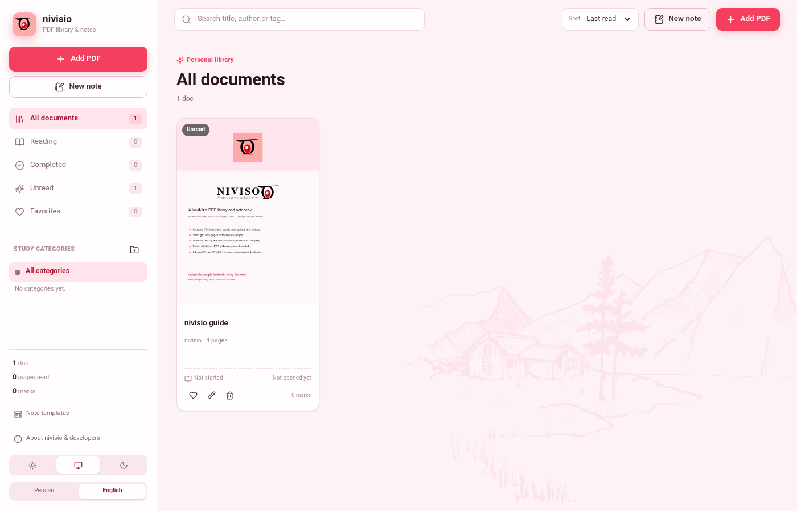
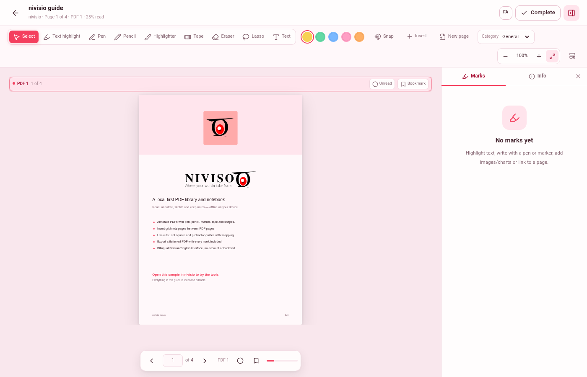
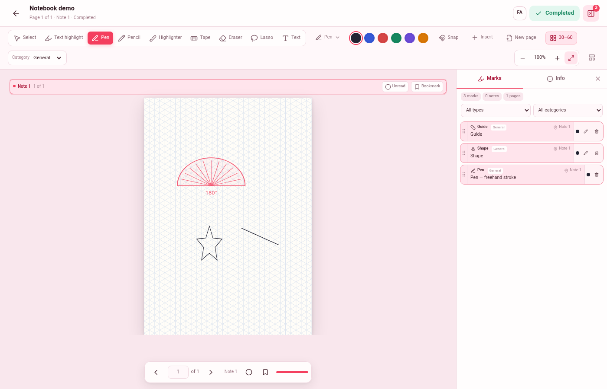
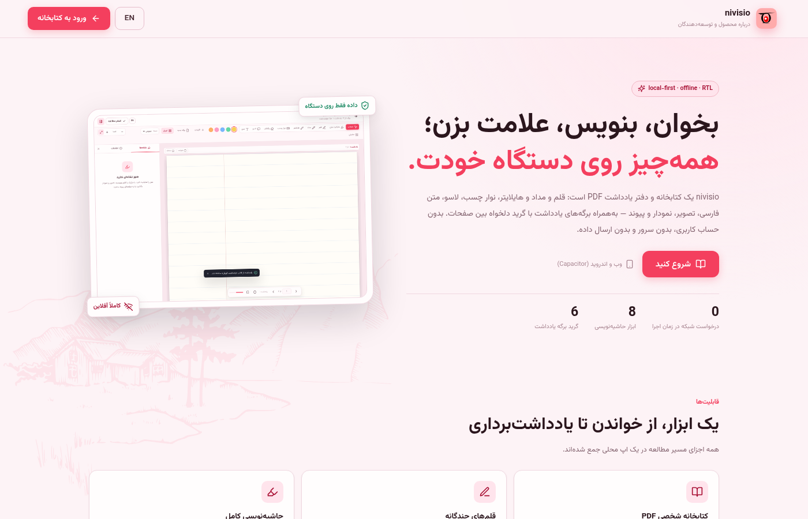
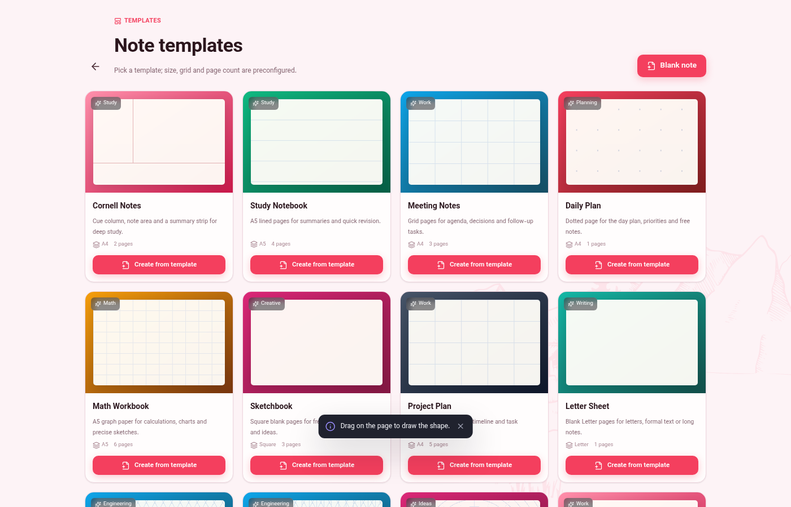
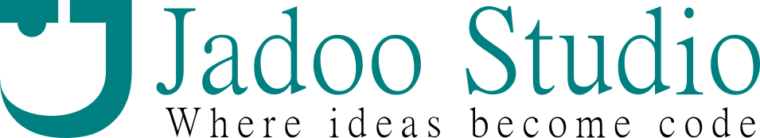

<div dir="rtl">

# نی‌ویسو (NIVISO)

<p align="center">
  
</p>

<p align="center">
  <strong>کتابخانهٔ محلی PDF، خواننده و دفتر یادداشت برای وب و اندروید.</strong><br />
  حاشیه‌نویسی، هایلایت، طراحی، شکل و ابزار اندازه‌گیری، برگه‌های یادداشت گریددار و خروجی PDF مسطح — آفلاین، خصوصی و دوزبانه.
</p>

<p align="center">
  <a href="https://github.com/ssmns/niviso/blob/main/LICENSE"></a>
  
  
  
  
</p>

<p align="center">
  <a href="./README.md">English</a> · <a href="#ویژگی‌ها">ویژگی‌ها</a> · <a href="#شروع-سریع">شروع سریع</a> · <a href="#اندروید">اندروید</a> · <a href="#حریم-خصوصی">حریم خصوصی</a> · <a href="#همکاری">همکاری</a>
</p>

---

> [ویژگی‌ها و تاریخچهٔ کامل تغییرات به فارسی](./CHANGELOG.fa.md)

## ویژگی‌ها

### کتابخانه و مطالعه
- کتابخانهٔ شخصی PDF با دسته‌بندی مطالعاتی، برچسب، موردعلاقه، کاور و عنوان نمایشی مستقل.
- ادامهٔ مطالعه از همان برگه، پیشرفت بر اساس صفحات منطقی، علامت خوانده/نخوانده و نشانک.
- نمایش تک‌صفحه، دو صفحه و پیوسته با تناسب عرض/ارتفاع و تم معمولی/کم‌نور/شب.
- رابط دوزبانه فارسی/انگلیسی با اعداد، تاریخ و برچسب‌های هماهنگ با زبان.

### حاشیه‌نویسی و طراحی
- خودکار، مداد، قلم نرم، قلم نی، خط‌چین و ماژیک با پشتیبانی از فشار استایلوس.
- هایلایت متن، هایلایتر آزاد، نوار چسب، پاک‌کن و لاسو.
- متن، تصویر شفاف (PNG/WebP)، نمودار، نوار چسب و شکل‌های قابل جابه‌جایی، تغییر اندازه و چرخش.
- شکل‌ها: خط، فلش، فلش منحنی، فلش بزیه، مستطیل، بیضی، دایره، مثلث، چندضلعی، ستاره، مارپیچ، قلب و لوزی با آیکون اختصاصی در انتخاب‌گر.
- نمودارهای میله‌ای، میله‌ای افقی، خطی، سطحی، نقطه‌ای، دایره‌ای و راداری.
- ابزار اندازه‌گیری: خط‌کش، گونیا و نقاله با اسنپ به لبه.
- اسنپ وابسته به گرید: خط‌دار، شطرنجی، نقطه‌ای، میلی‌متری، ایزومتریک، ۳۰–۶۰ واقعی و دایره‌ای.
- رسم خط مستقیم با قفل زاویه در گام‌های ۱۵ درجه.

### پنل خواننده
- سه تب **نشانه‌ها**، **اطلاعات** و **دارایی‌ها**؛ تب دارایی‌ها برای کلیپ‌آرت‌های آینده آماده شده است.

### یادداشت و خروجی
- سند یادداشت مستقل با اندازه‌های A4/A5/B5/Letter/مربع/دلخواه و جهت عمودی/افقی.
- گرید هر صفحه: خط‌دار، شطرنجی، نقطه‌ای، میلی‌متری، کورنل، ساده، ایزومتریک، ۳۰–۶۰ و دایره‌ای.
- تراکم گرید: ریز، متوسط و درشت.
- ۱۲ قالب آمادهٔ یادداشت.
- تغییر اندازهٔ صفحه هنگام ساخت، از تنظیمات سند یا از پنل اطلاعات خواننده.
- خروجی PDF مسطح شامل برگه‌های یادداشت، شکل‌ها، تصویرها، نمودارها، هایلایت‌ها و دست‌نوشته‌ها.
- همهٔ داده‌ها در IndexedDB روی دستگاه ذخیره می‌شوند. بدون حساب کاربری، سرور، تلمتری یا درخواست شبکه در زمان اجرا.

## تصاویر

| کتابخانه | خواننده |
| --- | --- |
|  |  |

| ابزارهای یادداشت | درباره |
| --- | --- |
|  |  |

<p align="center">
  
</p>

> ممکن است تصاویر کمی از آخرین رابط عقب‌تر باشند. برای دیدن نسخهٔ فعلی اپ را اجرا کنید.

## پشتهٔ فناوری

- **React 19 + TypeScript + Vite 6**
- **PDF.js** برای رندر و لایهٔ متن
- **pdf-lib** برای خروجی PDF مسطح (بارگذاری تنبل)
- **Dexie / IndexedDB** برای ذخیرهٔ محلی
- **React Router 7** با `HashRouter` برای سازگاری با Capacitor
- **Capacitor 6** برای اندروید
- CSS ساده با توکن طراحی؛ وزیرمتن برای متن فارسی
- بدون فریم‌ورک UI و بدون بک‌اند

## شروع سریع

پیش‌نیاز: Node.js 20+ و npm.

```bash
git clone https://github.com/ssmns/niviso.git
cd niviso
npm install
npm run dev
```

آدرس: <http://127.0.0.1:9180>

دستورهای مفید:

```bash
npm run typecheck   # بررسی TypeScript
npm run size        # بررسی اندازه و ماژولار بودن فایل‌ها
npm run build       # ساخت نسخهٔ production
npm run preview     # پیش‌نمایش نسخهٔ production
```

یا از اسکریپت کمکی استفاده کنید:

```bash
./script.sh setup
./script.sh dev
./script.sh verify
./script.sh sync
./script.sh doctor
```

## اندروید

پروژهٔ اندروید با Capacitor ساخته شده و در `android/` قرار دارد.

```bash
npm run build
npx cap sync android
```

برای ساخت APK دیباگ:

```bash
./script.sh apk
```

پیش‌نیاز: **JDK 17** و **Android SDK Platform 34 + Build-Tools 34**. اگر SDK کامل نباشد، `./script.sh doctor` موارد کم را نشان می‌دهد.

آیکون لانچر، آیکون adaptive (شامل monochrome)، تصاویر Splash و نام اپ از دارایی‌های برند نی‌ویسو در `public/` و `android/app/src/main/res/` استفاده می‌کنند.

## حریم خصوصی

نی‌ویسو از ابتدا آفلاین طراحی شده است:

- PDFها، هایلایت‌ها، یادداشت‌ها و تصویرها در IndexedDB روی دستگاه می‌مانند.
- حساب کاربری، سرور، دیتابیس یا تلمتری وجود ندارد.
- تنها راه خروج داده، PDF مسطح یا فایل اصلی است که خودتان می‌سازید.
- در زمان اجرا به درخواست شبکه نیازی نیست.

## ساختار پروژه

```text
niviso/
├── src/
│   ├── pages/                 # کتابخانه، خواننده، قالب‌ها، درباره
│   ├── components/            # UI مشترک و لایه‌های خواننده/صفحه
│   ├── hooks/                 # اکشن‌های خواننده، تنظیمات، خروجی، بارگذاری PDF
│   ├── lib/                   # مدل داده، DB، i18n، اسنپ، خروجی، قالب‌ها
│   └── styles/                # CSS موضوعی واردشده در global.css
├── public/                    # آیکون‌ها، لوگو، فونت‌ها، نمونه‌ها
├── android/                   # پروژهٔ اندروید Capacitor
├── docs/                      # تصاویر و مستندات عمومی
├── scripts/                   # بررسی‌کنندهٔ اندازهٔ فایل
└── script.sh                  # اسکریپت توسعه
```

## میان‌برهای صفحه‌کلید

| کار | میان‌بر |
| --- | --- |
| صفحهٔ بعد | `→` (انگلیسی) / `←` (فارسی) / `PageDown` / `Space` |
| صفحهٔ قبل | `←` (انگلیسی) / `→` (فارسی) / `PageUp` |
| بزرگ‌نمایی | `+` / `=` |
| کوچک‌نمایی | `−` |
| لغو انتخاب | `Esc` |
| حذف نشانهٔ انتخاب‌شده | `Delete` / `Backspace` |
| چرخش نوار | `Shift` + کشیدن دستگیره |

## نقشهٔ راه

- پشتیبان‌گیری و بازگردانی کامل کتابخانه.
- جستجو در متن سند و OCR.
- همگام‌سازی اختیاری چنددستگاهی با رمزنگاری سرتاسری.
- قالب‌های بیشتر برای خروجی و چاپ.

## همکاری

از مشارکت استقبال می‌کنیم. لطفاً اول [CONTRIBUTING.md](./CONTRIBUTING.md) و [SECURITY.md](./SECURITY.md) را بخوانید.

- تغییرات را با ساختار، نام‌گذاری و رابط دوزبانهٔ موجود هماهنگ نگه دارید.
- قبل از ارسال Pull Request دستور `./script.sh verify` را اجرا کنید.
- برای تغییرات UI اسکرین‌شات یا ویدئوی کوتاه اضافه کنید.
- برای هر متن جدید UI، نسخهٔ فارسی و انگلیسی را اضافه کنید.

## توسعه‌دهنده

<p align="right">
  
</p>
<p align="right">
  
</p>

**جادو استودیو (Jadoo Studio)** — ایده، طراحی محصول، مهندسی و پیاده‌سازی.  
*Where ideas become code.*

## لایسنس

MIT — فایل [LICENSE](./LICENSE). حق نشر © ۲۰۲۶ جادو استودیو.

---

<p align="center">
  <a href="./README.md">English version</a> · ساخته‌شده برای خواندن، نوشتن و اندیشیدن.
</p>

</div>
