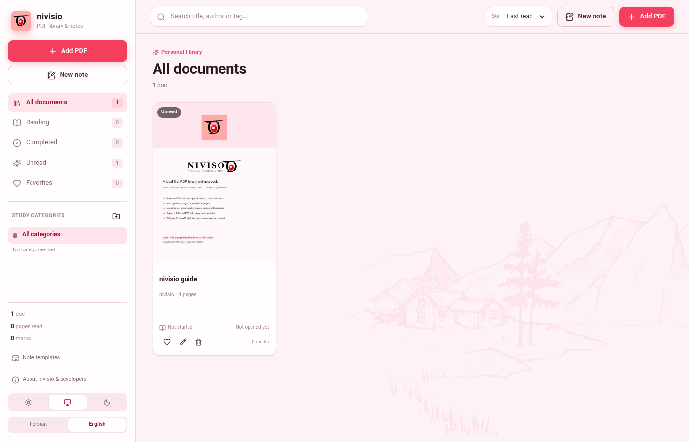
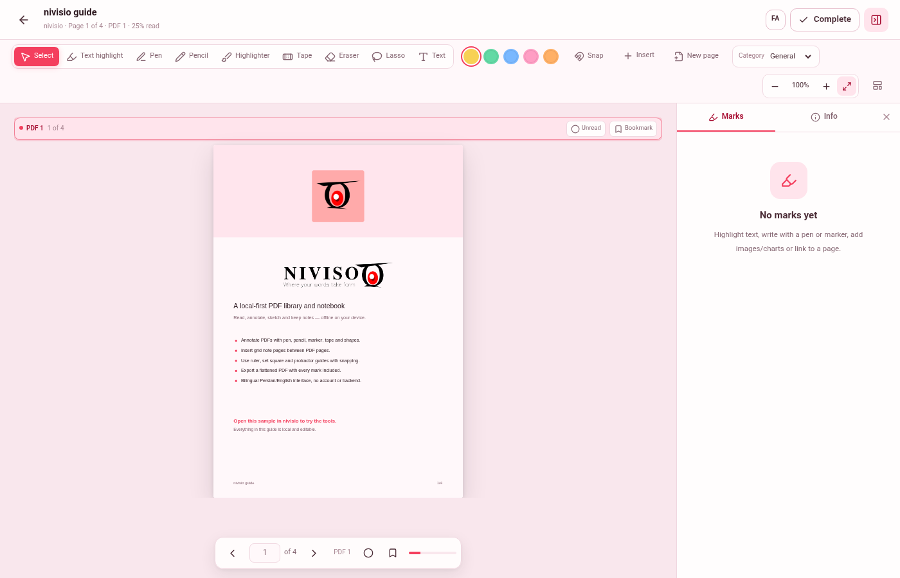
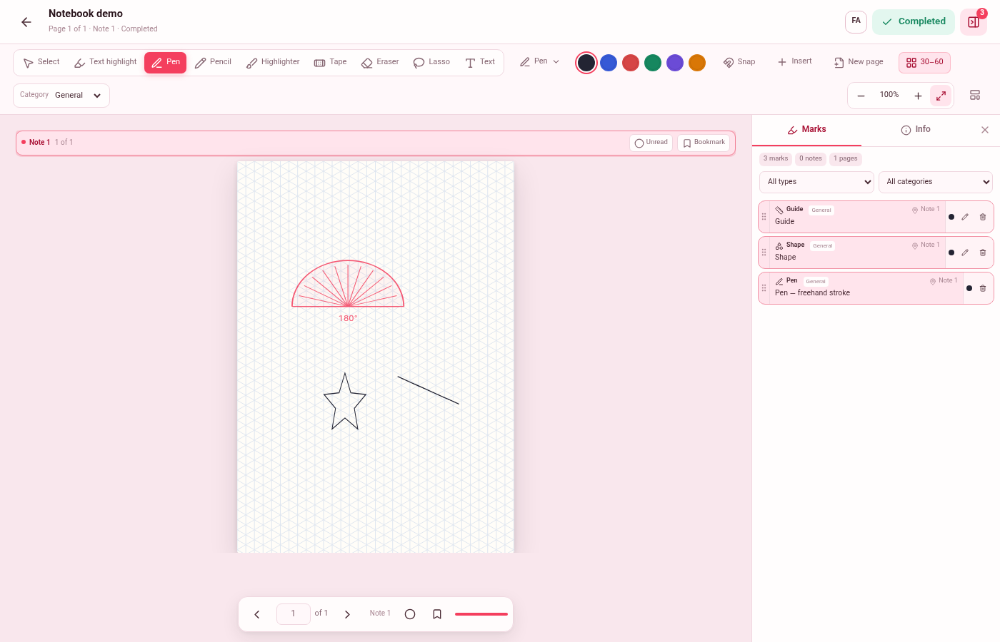
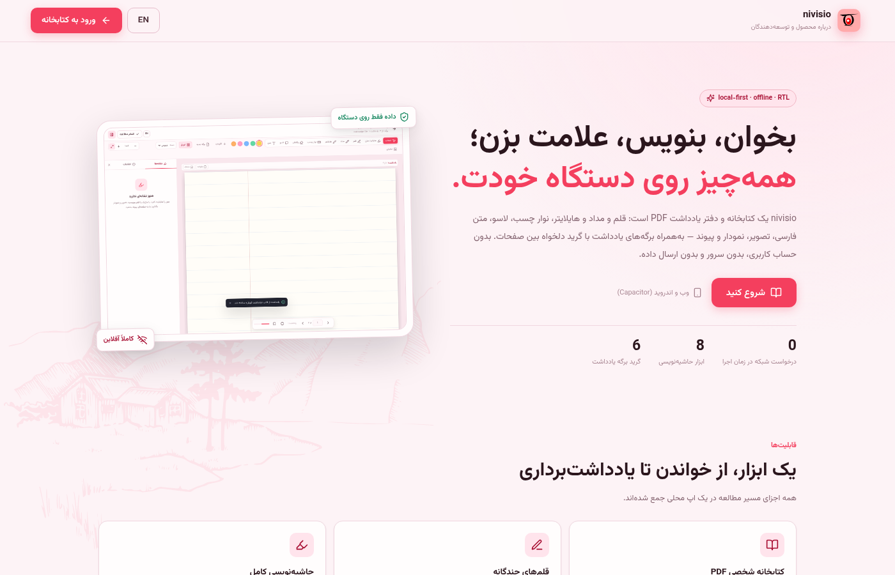
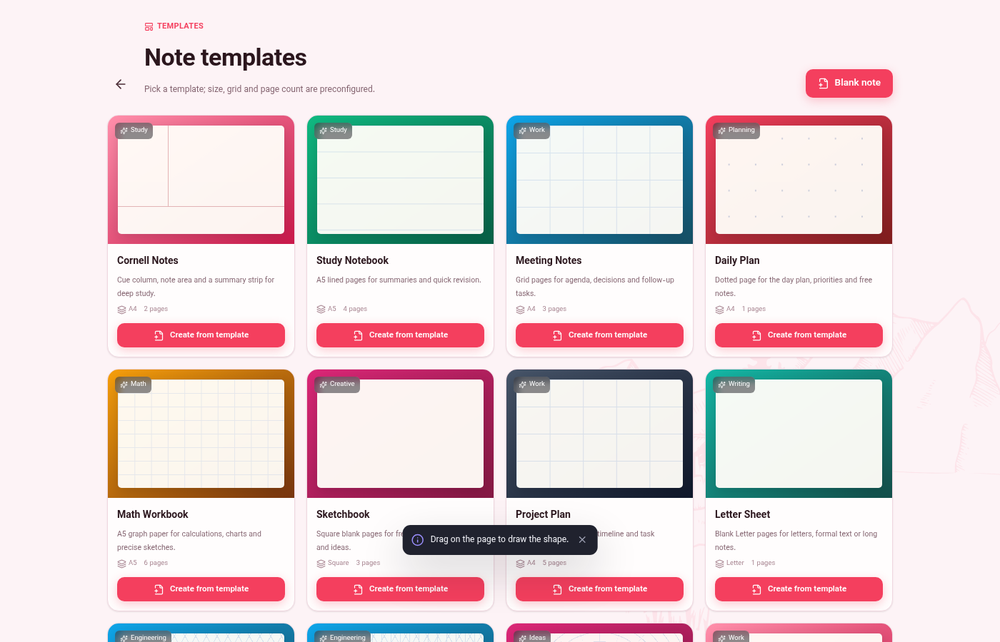
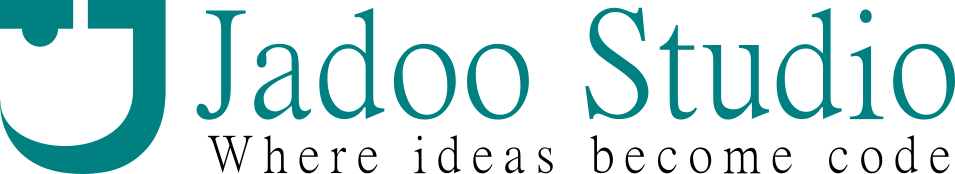

# nivisio

<p align="center">
  
</p>

<p align="center">
  <strong>A local-first PDF library, reader and notebook for web and Android.</strong><br />
  Annotate, highlight, sketch, add shapes and measuring guides, insert grid note pages, and export flattened PDFs — offline, private, and bilingual.
</p>

<p align="center">
  <a href="https://github.com/ssmns/nivisio/blob/main/LICENSE"></a>
  
  
  
  
</p>

<p align="center">
  <a href="./README.fa.md">فارسی</a> · <a href="#features">Features</a> · <a href="#quick-start">Quick start</a> · <a href="#android">Android</a> · <a href="#privacy">Privacy</a> · <a href="#contributing">Contributing</a>
</p>

---

> **Repository:** [github.com/ssmns/nivisio](https://github.com/ssmns/nivisio)
>
> [Full Persian feature list and changelog](./CHANGELOG.fa.md)

## The name

**NIVISIO** (نیویسیو, also read **Niviso**) comes from the ancient Persian root
*niwīstan* / *niwīsidan* (نیویسدن، نبشتن; Middle Persian: *niwīstan*), meaning **to
write and inscribe**. The name describes a note-taking and document tool while
matching the modern Android app identity and logo.

## Features

### Library and reading
- Personal PDF library with study collections, tags, favorites, covers and independent display titles.
- Resume exactly where you left off with logical-page progress, read/unread marks and bookmarks.
- Single-page, two-page and continuous views with fit-width/fit-height and normal/dim/night PDF themes.
- Anchored pinch/double-tap zoom and horizontal panning on touch, plus a dedicated pan tool.
- Bilingual UI (Persian/RTL and English/LTR) with locale-aware digits, dates and labels.

### Annotation and drawing
- Pen, pencil, soft brush, fountain pen, dashed pen and marker with stylus pressure.
- Text highlighting, freehand highlighter, tape, eraser and lasso.
- Movable, resizable and rotatable text, images (transparent PNG/WebP), charts, tape and shapes.
- Shapes: line, arrow, curved arrow, Bézier arrow, rectangle, ellipse, circle, triangle, polygon and star with custom point count; every kind has an icon in the picker.
- Lines and arrows are defined by two draggable endpoints; curved and Bézier arrows also expose bend handles.
- Charts: bar, line, area, pie and radar with editable labels, values, colors and backgrounds.
- Measuring guides: ruler, set square and protractor, with guide-edge snapping.
- Grid-aware snapping: ruled, grid, dotted, graph, isometric, true 30–60 and circular paper.
- Straight lines with 15° angle snapping.

### Notes and export
- Standalone note documents with A4/A5/B5/Letter/Square/custom sizes and portrait/landscape orientation.
- Per-page grids: lined, grid, dotted, graph, Cornell, blank, isometric, 30–60 and circular.
- Grid density: fine, medium and large.
- 12 ready-made note templates.
- Page size can be changed while creating, from document settings, or from the reader info panel.
- Flattened PDF export including note pages, shapes, images, charts, highlights and handwriting.
- Everything is stored in IndexedDB on the device. No account, backend, telemetry or runtime network calls.

## Screenshots

| Library | Reader |
| --- | --- |
|  |  |

| Note tools | About |
| --- | --- |
|  |  |

<p align="center">
  
</p>

> Screenshots may lag slightly behind the latest UI. Run the app to see the current build.

## Tech stack

- **React 19 + TypeScript + Vite 6**
- **PDF.js** for rendering and the text layer
- **pdf-lib** for flattened PDF export (lazy-loaded)
- **Dexie / IndexedDB** for local persistence
- **React Router 7** with `HashRouter` for Capacitor compatibility
- **Capacitor 6** for Android
- Plain CSS with design tokens; Vazirmatn for Persian text
- No UI framework and no backend

## Quick start

Requirements: Node.js 20+ and npm.

```bash
git clone https://github.com/ssmns/nivisio.git
cd nivisio
npm install
npm run dev
```

Open <http://127.0.0.1:9180>.

Useful commands:

```bash
npm run typecheck   # TypeScript
npm run size        # file-size/modularity check
npm run build       # production build
npm run preview     # preview production build
```

Or use the helper script:

```bash
./script.sh setup
./script.sh dev
./script.sh verify
./script.sh sync
./script.sh doctor
```

## Android

The Android project is generated with Capacitor and lives in `android/`.

```bash
npm run build
npx cap sync android
```

To build a debug APK:

```bash
./script.sh apk
```

Requirements: **JDK 17** and **Android SDK Platform 34 + Build-Tools 34**. If the SDK is incomplete, `./script.sh doctor` explains what is missing.

The launcher icon, adaptive icon (including monochrome), splash screens and app name use the nivisio brand assets in `public/` and `android/app/src/main/res/`.

## Privacy

nivisio is offline by design:

- PDFs, highlights, notes and images stay in IndexedDB on your device.
- There is no account, server, database or telemetry.
- The only data export is the flattened PDF or original file you create yourself.
- No runtime network requests are required.

## Project structure

```text
nivisio/
├── src/
│   ├── pages/                 # Library, reader, templates, about
│   ├── components/            # Shared UI and reader/page layers
│   ├── hooks/                 # Reader actions, preferences, export, PDF loading
│   ├── lib/                   # Data model, DB, i18n, snapping, export, templates
│   └── styles/                # Focused CSS modules imported by global.css
├── public/                    # Icons, logo, fonts, samples, screenshots
├── android/                   # Capacitor Android project
├── docs/                      # Screenshots and public documentation
├── scripts/                   # File-size checker
└── script.sh                  # Developer helper
```

## Keyboard shortcuts

| Action | Shortcut |
| --- | --- |
| Next page | `→` (LTR) / `←` (RTL) / `PageDown` / `Space` |
| Previous page | `←` (LTR) / `→` (RTL) / `PageUp` |
| Zoom in | `+` / `=` |
| Zoom out | `−` |
| Clear selection | `Esc` |
| Delete selected mark | `Delete` / `Backspace` |
| Rotate tape | `Shift` + drag handle |

## Roadmap

- Full backup/restore of the local library.
- In-document text search and OCR.
- Optional end-to-end encrypted multi-device sync.
- More export presets and print layouts.

## Contributing

Contributions are welcome. Please read [CONTRIBUTING.md](./CONTRIBUTING.md) and [SECURITY.md](./SECURITY.md) first.

- Keep changes consistent with the existing structure, naming and bilingual UI.
- Run `./script.sh verify` before opening a pull request.
- Include screenshots or a short recording for UI changes.
- Add English and Persian text for every new UI string.

## Developer

<p align="left">
  
</p>
<p align="left">
  
</p>

**Jadoo Studio** — concept, product design, engineering and development.  
*Where ideas become code.*

## License

MIT — see [LICENSE](./LICENSE). Copyright © 2026 Jadoo Studio.

---

<p align="center">
  <a href="./README.fa.md">نسخه فارسی</a> · Built with care for reading, writing and thinking.
</p>
